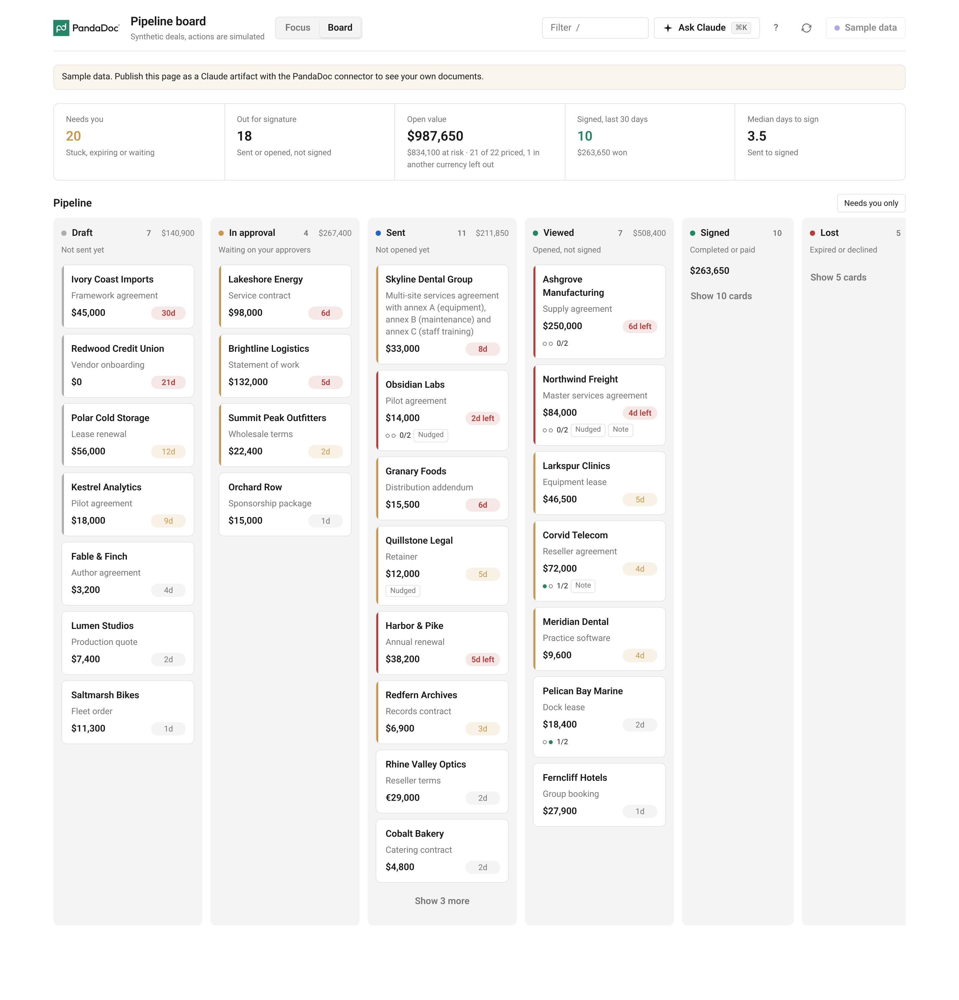
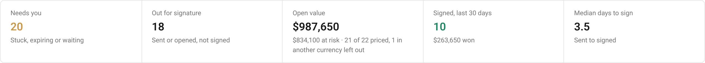
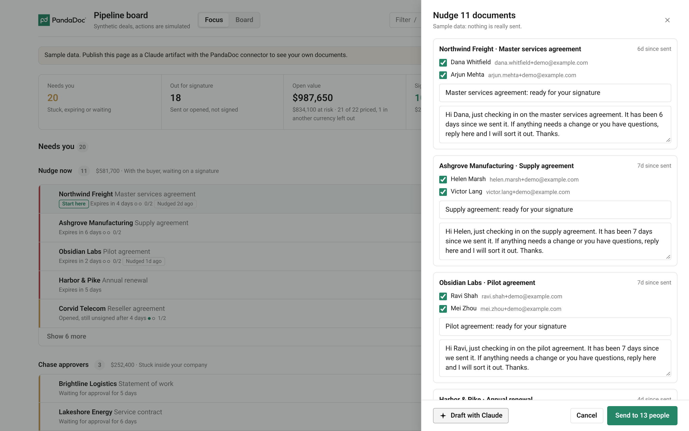
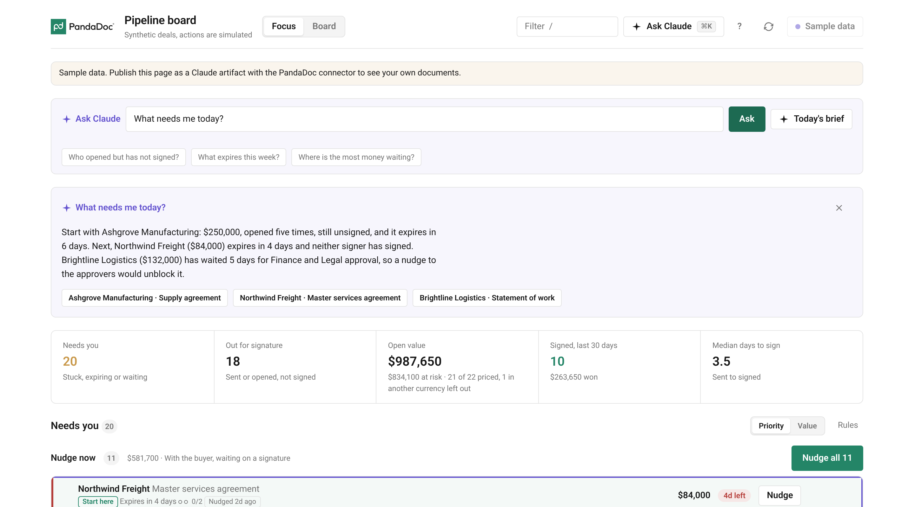
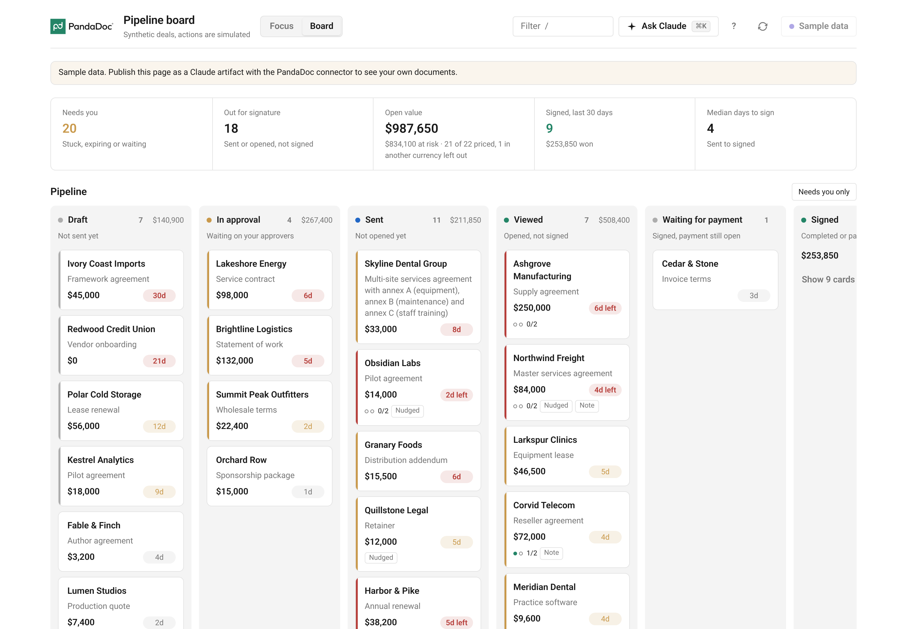

# PandaDoc Pipeline board

A pipeline dashboard built as a Claude artifact on top of [PandaDoc MCP](https://developers.pandadoc.com/docs/use-pandadoc-mcp-server). It reads your PandaDoc documents through your own connector in Claude, shows what needs your attention, and helps you act on it. There is no server to host. The whole board is one HTML file: [`pipeline-board.html`](pipeline-board.html).

*The full board. Each lane is a stage, and each card shows the account, the value, how long it has waited, and who has signed.*

## What it shows

- **Who opened a document but hasn't signed.** Viewed documents with missing signatures, including deals where one of two signers is still outstanding.
- **What expires this week.** Documents close to their expiration date are flagged so you can follow up in time.
- **Where the most money is waiting.** Open value, value at risk, and a queue you can sort by deal size.
- **One-click reminder drafts.** Pick a group of documents, let Claude draft a short reminder for each signer, and review every message and recipient before anything is sent.
- **Ask Claude, built in.** Ask a question about your pipeline in plain words and get an answer that points to the cards it is talking about.
- **A board you can change by asking.** Tell Claude what you want, for example "treat a deal as stuck after two days", "add a lane for payments", or "group by account", and it updates the artifact for you.

*The KPI row. Each tile is also a shortcut into a filtered view.*

*The reminder sheet. Every recipient is listed with a checkbox, and Claude's drafts stay editable until you press send.*

*Ask Claude answering "What needs me today?". The documents it mentions are highlighted on the board.*

*A customized board after asking Claude to "add a lane for documents waiting for payment".*

## How to use it

1. Connect PandaDoc MCP in Claude. The setup steps are in the [PandaDoc MCP docs](https://developers.pandadoc.com/docs/use-pandadoc-mcp-server).
2. Download [`pipeline-board.html`](pipeline-board.html).
3. In Claude, attach the file and ask Claude to build a Claude artifact from it, with access to your PandaDoc connector. You can also paste the file contents into the chat.
4. Open the artifact and allow PandaDoc and Claude when asked.

The board opens on sample data, so you can look around before connecting anything. A button in the top right switches between the sample data and your own documents. Nothing is sent or changed in PandaDoc until you confirm it in a sheet.

## Sample data

The screenshots use the board's built-in sample data. Every company, person, and amount in it is made up. Reminders sent in sample mode are simulated. The Ask Claude answer and the reminder drafts shown in the screenshots are example text written for this sample data.
